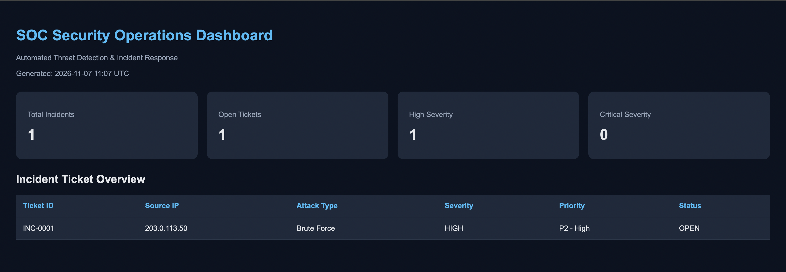
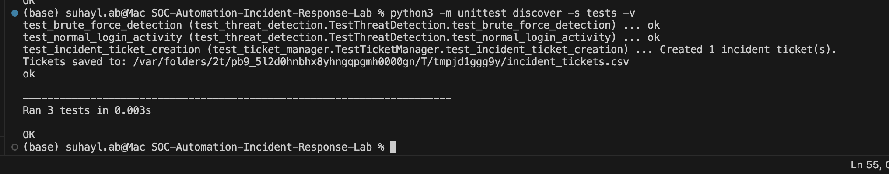

# SOC Automation & Incident Response Lab

A Python-based Security Operations Centre (SOC) automation project that simulates threat detection, incident response, security ticket generation, and dashboard reporting.

The project demonstrates how common SOC workflows can be automated to help security analysts identify suspicious activity, prioritise incidents, and review security alerts.

## Features

- **Automated Threat Detection:** Identifies potential brute-force attacks by detecting five or more failed login attempts from the same IP address within 60 seconds.
- **Security Alert Generation:** Records detected threats in CSV format with timestamps, source IP addresses, attack types, and severity levels.
- **Incident Response Reporting:** Generates incident reports containing security findings and recommended response actions.
- **Automated Incident Ticketing:** Creates incident tickets with unique IDs, severity classifications, priorities, and statuses.
- **SOC Security Dashboard:** Generates a dark-themed HTML dashboard displaying incident statistics and ticket details.
- **Automated Testing:** Uses Python's `unittest` framework to verify threat detection, normal login behaviour, and ticket creation.

## Technologies Used

- Python 3
- CSV log processing
- HTML and CSS
- Python `unittest`
- Python `pathlib`
- Git and GitHub
- Visual Studio Code

## Project Structure

```text
SOC-Automation-Incident-Response-Lab/
├── alerts/
│   └── security_alerts.csv
├── data/
│   └── security_logs.csv
├── reports/
│   ├── incident_report.txt
│   ├── incident_tickets.csv
│   └── soc_dashboard.html
├── screenshots/
│   ├── all-tests-passed.png
│   └── automated-tests-passed.png
├── src/
│   ├── dashboard.py
│   ├── detect_threats.py
│   ├── generate_logs.py
│   ├── incident_response.py
│   ├── soc_automation.py
│   └── ticket_manager.py
├── tests/
│   ├── test_threat_detection.py
│   └── test_ticket_manager.py
├── .gitignore
└── README.md
```

## How It Works

1. The system reads simulated security authentication logs.
2. The detection engine identifies suspicious failed login activity.
3. Detected threats are saved to `security_alerts.csv`.
4. The incident response module generates a report with recommended actions.
5. The ticket manager creates incident tickets and assigns priorities.
6. The dashboard generator produces an HTML overview of the incidents.

The project provides a simulated SOC workflow. It does not automatically block IP addresses or modify real security infrastructure.

## Running the Project

**Requirements:** Python 3. No external Python packages are required.

From the project root, generate sample logs:

```bash
python3 src/generate_logs.py
```

Run the automated SOC workflow:

```bash
python3 src/soc_automation.py
```

Generate or refresh the dashboard separately:

```bash
python3 src/dashboard.py
```

Open `reports/soc_dashboard.html` in a web browser to view the dashboard.

## SOC Dashboard Preview

The project generates an HTML-based SOC dashboard that displays:

- Total detected security incidents
- Open incident tickets
- High and critical severity incidents
- Incident IDs, suspicious IPs, attack types, priorities, and statuses

The dashboard is automatically generated from incident ticket data.



## Automated Testing

Run all tests from the project root:

```bash
python3 -m unittest discover -s tests -v
```

Three automated tests were successfully completed:

| Test | Result |
|---|---|
| Brute-force attack detection | Passed |
| Normal login activity | Passed |
| Incident ticket creation | Passed |

### Test Evidence



## Example Incident

The simulated authentication logs produced the following security incident:

| Field | Value |
|---|---|
| Source IP | 203.0.113.50 |
| Attack Type | Brute Force |
| Failed Login Attempts | 5 |
| Severity | HIGH |
| Priority | P2 - High |
| Ticket ID | INC-0001 |
| Status | OPEN |

The IP address is an example address used for simulation and documentation.

## Recommended Incident Response

The system generates recommendations for analysts to:

1. Investigate authentication logs.
2. Review suspicious IP activity.
3. Consider temporary IP blocking after verification.
4. Check affected accounts for compromise.
5. Escalate the incident to a SOC analyst.

These are recommendations rather than automatically executed remediation actions.

## Limitations

- Uses simulated authentication logs rather than live SIEM data.
- Incident tickets are stored locally in CSV files.
- The dashboard is a generated HTML report, not a live monitoring application.
- Detection currently focuses on brute-force login attempts.
- Ticket statuses are initially assigned as OPEN.
- The detection threshold is fixed at five failures within 60 seconds.

## Skills Demonstrated

- Security log analysis
- Brute-force attack detection
- SOC workflow automation
- Incident response procedures
- Security alerting and reporting
- Incident prioritisation
- Python scripting and automated testing
- Security dashboard development

## Future Improvements

- Integrate real-time log ingestion.
- Support additional attack detection rules.
- Add ticket status management and analyst assignment.
- Introduce SIEM or threat intelligence integrations.
- Add automated notifications and richer dashboard visualisations.

## Disclaimer

This project was developed for cybersecurity education and portfolio demonstration purposes. All security incidents and log data are simulated.